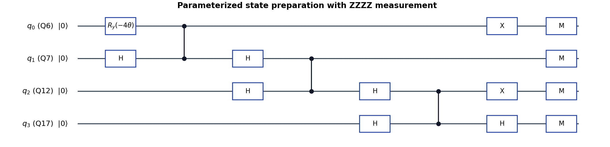
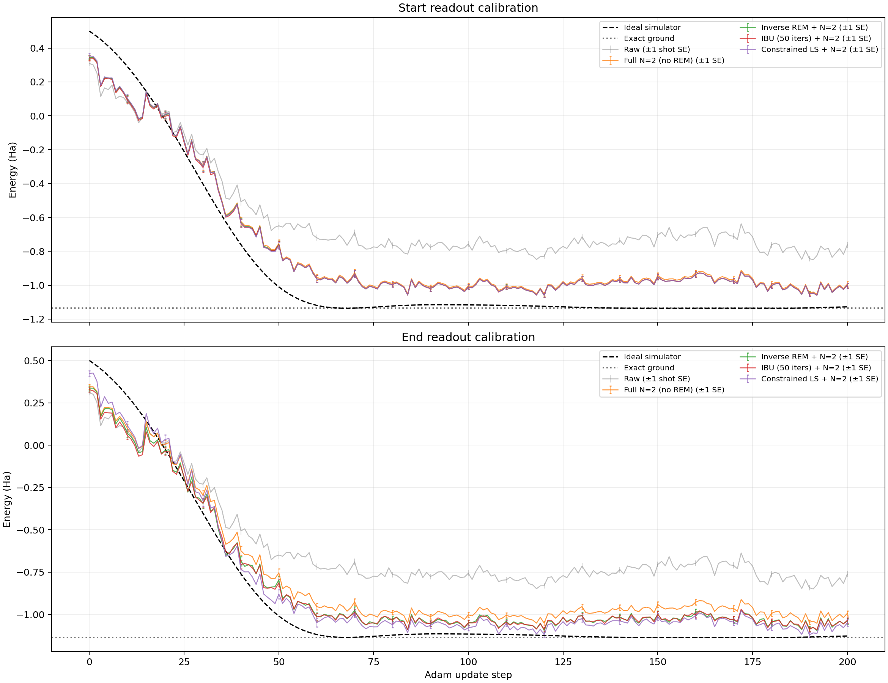

# H₂ 真机 VQE：0–200 步与八种后处理方法

[逐步结果表](results/0-200逐步结果.md) · [八方法 CSV](results/steps_000_200_eight_methods.csv) · [收敛图](results/offline_methods_comparison.png) · [复现说明](REPRODUCIBILITY.md)

本项目整理 R=0.700 Å、STO-3G 四比特 H₂ 超导真机实验的 0–200 步结果。逻辑 q0–q3 顺序对应物理 [Q6,Q7,Q12,Q17]，每个测量基 1024 shots；每一步的目标是完整 N=2 投影能量，优化器为 parameter-shift + Adam。能量单位 Ha，含核间排斥项。原始实验完成 200 次参数更新，本次整理只执行离线后处理。

八种结果为 Raw、未做 REM 的完整 N=2，以及直接求逆、IBU、约束最小二乘三种 REM 分别采用开始或结束校准后再计算完整 N=2。理想模拟器作为单独参考，不计入八种真机后处理结果。图中两套端点校准均作用于全曲线，是敏感性分析，而不是逐步实际校准。

## 参数化量子线路

下图展示 `build_circuit(theta, 'ZZZZ')` 的逻辑门结构：唯一的参数化门是 q0 上的 $R_y(-4\theta)$；三个 CZ 依次作用于相邻比特对。即使 $\theta=0$，原始线路也保留这三个 CZ。图按实际门之间可交换的顺序排列，M 表示计算基测量；这是逻辑线路，不代表云平台编译后的物理脉冲或线路深度。

理想制备态为 $\cos(2\theta)|1010\rangle-\sin(2\theta)|0101\rangle$，位串从左到右对应 q0、q1、q2、q3。测量使用 `ZZZZ`、`XXXX`、`XXYY`、`YYXX`、`YYYY` 五个基。图只画 `ZZZZ`：其他基的末端测量旋转见 [线路快照](data/circuit_source.py)；例如 q3 原有末端 H 与 X 基变换可抵消，与 Y 基变换合并为 $R_x(-\pi/2)$。源码快照中的旧布局默认值由实验驱动覆盖；本实验实际布局为 [Q6,Q7,Q12,Q17]。

## 八种结果的计算方法

令 $\Pi_2$ 为两个电子的粒子数投影算符，$A=\langle\Pi_2H\Pi_2\rangle$，$p=\langle\Pi_2\rangle$，完整投影能量为 $E_2=A/p$。本实验 Hamiltonian 的非对角部分 $V$ 满足 $\Pi_2V\Pi_2=V$：`ZZZZ` 提供投影对角分子和分母，四个 X/Y 基提供非对角部分，不能对 X/Y 测量位串直接按两个 1 筛选。

读出误差缓解（REM）使用同布局 `0000`、`1111` 对照构造单比特赋值矩阵，并假设各比特读出误差独立。开始校准和结束校准是两套不同时间的数据；以下第 3–8 项每项都先分别校正五个测量基，再一致地计算 $A$ 与 $p$，最后取比值。

| 编号 | 结果 | 具体处理 |
|---:|---|---|
| 1 | **Raw** | 直接从五基原始 counts 计算 Hamiltonian 期望值，不做 REM 或粒子数投影。 |
| 2 | **完整 N=2** | 从原始 counts 估计 $A/p$；不做 REM。 |
| 3 | **直接求逆 REM + N=2，开始校准** | 使用开始时的读出矩阵逆变换测量分布，然后计算 $A/p$；逆变换可产生负准概率。 |
| 4 | **IBU + N=2，开始校准** | 使用开始校准进行迭代贝叶斯展开；均匀初始分布、50 次迭代，然后计算 $A/p$。 |
| 5 | **约束优化 REM + N=2，开始校准** | 使用开始校准，在 $p_i\ge0$、$\sum_i p_i=1$ 的条件下，对各基独立最小化 $\|Mp-f\|^2/2$，再计算 $A/p$。 |
| 6 | **直接求逆 REM + N=2，结束校准** | 方法与第 3 项相同，改用第 200 步后的结束校准。 |
| 7 | **IBU + N=2，结束校准** | 方法与第 4 项相同，改用结束校准。 |
| 8 | **约束优化 REM + N=2，结束校准** | 方法与第 5 项相同，改用结束校准。 |

IBU 和约束优化得到的各基分布非负归一，但逐基处理不保证这些分布对应同一个物理密度矩阵。REM 对照还混有态制备误差，独立读出模型不包含相关读出误差，也不直接消除线路门误差。

## 0–200 步收敛图

上、下图分别使用开始和结束校准；Raw、未校正 N=2 及模拟器曲线在两图中相同。图中每 10 步标一根 ±1 倍采样标准误：Raw/N=2 使用 shots 统计估计；REM 方法使用 200 次 bootstrap，同时重采样校准和实验 counts。有限 bootstrap 对未观察到的罕见校准错误可能低估不确定度。完整逐步数据和每步误差见 [CSV](results/steps_000_200_eight_methods.csv)。

## 结果摘要

| 方法 | 步数 0 / Ha | 步数 200 / Ha | 最低值 / Ha | 最低点 |
|---|---:|---:|---:|---:|
| Raw | 0.309085 | −0.762388 | −0.850190 | 191 |
| 完整 N=2 | 0.344353 | −0.994480 | −1.052798 | 192 |
| 直接求逆，开始校准 | 0.344938 | −1.001012 | −1.059334 | 192 |
| IBU，开始校准 | 0.340410 | −1.001011 | −1.059345 | 192 |
| 约束最小二乘，开始校准 | 0.353735 | −1.001012 | −1.059432 | 192 |
| 直接求逆，结束校准 | 0.336146 | −1.039685 | −1.095571 | 192 |
| IBU，结束校准 | 0.327558 | −1.035605 | −1.091130 | 192 |
| 约束最小二乘，结束校准 | 0.423758 | −1.050508 | −1.121353 | 190 |

最低单点 −1.121353 ± 0.016392 Ha 对应 θ=0.03519448 rad；没有经过独立重复测量，不能单凭它判断方法最准确。精确基态为 −1.136189454 Ha。误差条为有限 shots 采样标准误，不包含门误差、漂移、模型误差和自适应选择。结束校准直接求逆在 201 点中有 50 点给出大于 1 的非物理投影权重；IBU 和约束优化让各基概率非负归一，但不保证各基来自同一物理态。

## 文件结构

- `data/`：原始实验状态和 counts、任务编号、线路源快照、校准矩阵、软件环境及模拟器验证。
- `code/`：完整 N=2 估计器和从 counts 离线重算八种方法的代码。
- `results/`：201 步八方法宽表、1608 行长表、带误差的完整 Markdown 表、方法汇总、原始详细结果和收敛图。
- `protocols/`：实验设置、统计方法、校准及局限。
- `scripts/`：从详细结果派生表格并核验主测量点。
- `REPRODUCIBILITY.md`、`requirements.lock.txt`、`SHA256SUMS.txt`：复现流程、依赖和文件哈希。

