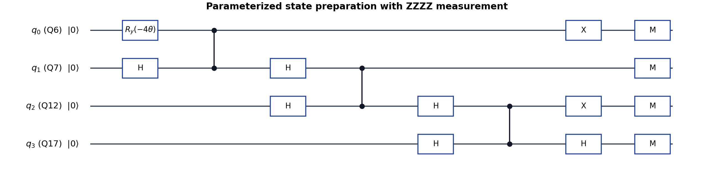
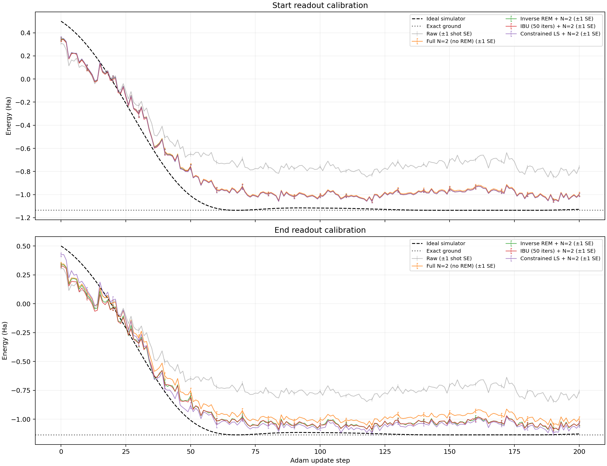

# H₂ Hardware VQE: 200 Steps and Eight Post-processing Results

[中文 README](README.md) · [Step-by-step results](results/0-200逐步结果.md) · [Eight-method CSV](results/steps_000_200_eight_methods.csv) · [Convergence plot](results/offline_methods_comparison.png) · [Reproducibility](REPRODUCIBILITY.md)

This project records a four-qubit STO-3G H₂ VQE experiment at R = 0.700 Å on superconducting hardware. Logical qubits q0–q3 map in order to [Q6, Q7, Q12, Q17]. Each measurement basis uses 1,024 shots. The optimization objective is the full N=2 projected energy, with parameter-shift gradients and Adam updates. Energies are in Hartree (Ha) and include nuclear repulsion. The original experiment completed 200 parameter updates; the mitigation analysis is offline post-processing.

The [SCQ-2 chip performance table](data/SCQ-2-chip-data-20261030.csv) used for layout selection reports T1, T2, readout, single-qubit and CZ-gate metrics. It is an unchanged copy of `SCQ-2-chip-data (4).csv`; the source file's local modification time was 2026-10-30 14:37 Beijing time. This is not necessarily the chip calibration time and does not establish that the metrics were stable throughout the experiment.

The eight results comprise raw energy, full N=2 without REM, and three readout error mitigation (REM) methods followed by full N=2 projection, each evaluated with start and end calibrations. The ideal simulator is a separate reference. Applying either endpoint calibration to the entire trajectory is a sensitivity analysis, not a measurement of the calibration at every step.

## Parameterized circuit

The figure shows the logical gates of `build_circuit(theta, 'ZZZZ')`. The only parameterized gate is $R_y(-4\theta)$ on q0. Three CZ gates act successively on adjacent qubit pairs and remain in the circuit even at $\theta=0$. Gates that commute have been arranged for clarity; M denotes computational-basis measurement. The diagram is not a compiled pulse schedule or physical circuit depth.

The ideal prepared state is $\cos(2\theta)|1010\rangle-\sin(2\theta)|0101\rangle$, with bitstrings ordered q0, q1, q2, q3. The five measurement bases are `ZZZZ`, `XXXX`, `XXYY`, `YYXX`, and `YYYY`. Only `ZZZZ` is drawn; the other basis rotations are in the [circuit snapshot](data/circuit_source.py). For example, the final H on q3 cancels with the X-basis change and combines with the Y-basis change into $R_x(-\pi/2)$. The snapshot's legacy layout default was overridden by the experiment driver; the actual layout was [Q6,Q7,Q12,Q17].

## Eight post-processing results

Let $\Pi_2$ project onto the two-electron sector, $A=\langle\Pi_2H\Pi_2\rangle$, and $p=\langle\Pi_2\rangle$. The full projected energy is $E_2=A/p$. For this Hamiltonian, its off-diagonal part $V$ satisfies $\Pi_2V\Pi_2=V$: `ZZZZ` supplies the projected diagonal numerator and denominator, while the four X/Y bases supply the off-diagonal part. Filtering X/Y measurement bitstrings by the number of ones is not an equivalent projection.

REM constructs single-qubit assignment matrices from `0000` and `1111` controls on the same physical layout and assumes independent readout errors. The start and end controls were collected at different times. In methods 3–8, all five basis distributions are corrected under the chosen calibration, then $A$ and $p$ are calculated consistently before taking their ratio.

| No. | Result | Procedure |
|---:|---|---|
| 1 | **Raw** | Evaluate the Hamiltonian from the five raw counts, without REM or particle-number projection. |
| 2 | **Full N=2** | Estimate $A/p$ from raw counts, without REM. |
| 3 | **Inverse REM + N=2, start** | Invert the start-calibration assignment matrix, then evaluate $A/p$; inversion can yield negative quasi-probabilities. |
| 4 | **IBU + N=2, start** | Apply iterative Bayesian unfolding (IBU) with the start calibration, uniform prior and 50 iterations, then evaluate $A/p$. |
| 5 | **Constrained REM + N=2, start** | For each basis, minimize $\|Mp-f\|^2/2$ using the start calibration subject to $p_i\ge0$ and $\sum_i p_i=1$, then evaluate $A/p$. |
| 6 | **Inverse REM + N=2, end** | As in method 3, with the calibration collected after step 200. |
| 7 | **IBU + N=2, end** | As in method 4, with the end calibration. |
| 8 | **Constrained REM + N=2, end** | As in method 5, with the end calibration. |

IBU and constrained least squares produce nonnegative normalized distributions for each basis, but independent basis fits do not guarantee one shared physical density matrix. Controls also include state-preparation errors; the independent readout model omits correlated readout errors and does not directly remove gate errors.

## Convergence: steps 0–200

The top and bottom panels use start and end calibrations, respectively. Raw, uncorrected N=2, and ideal curves are identical in both panels. Error bars are shown every ten steps at ±1 sampling standard error: Raw/N=2 use shot-statistical estimates; REM methods use 200 bootstrap replicates resampling both calibration and experiment counts. Finite bootstrap sampling may underestimate uncertainty in rare calibration errors that were not observed. The [CSV](results/steps_000_200_eight_methods.csv) contains every step and its uncertainty.

## Results

| Method | Step 0 / Ha | Step 200 / Ha | Lowest point / Ha | Step |
|---|---:|---:|---:|---:|
| Raw | 0.309085 | −0.762388 | −0.850190 | 191 |
| Full N=2 | 0.344353 | −0.994480 | −1.052798 | 192 |
| Inverse, start | 0.344938 | −1.001012 | −1.059334 | 192 |
| IBU, start | 0.340410 | −1.001011 | −1.059345 | 192 |
| Constrained least squares, start | 0.353735 | −1.001012 | −1.059432 | 192 |
| Inverse, end | 0.336146 | −1.039685 | −1.095571 | 192 |
| IBU, end | 0.327558 | −1.035605 | −1.091130 | 192 |
| Constrained least squares, end | 0.423758 | −1.050508 | −1.121353 | 190 |

The lowest single estimate, −1.121353 ± 0.016392 Ha at θ=0.03519448 rad, has not been independently remeasured and does not by itself establish the most accurate method. The exact ground energy is −1.136189454 Ha. Sampling errors exclude gate errors, drift, model errors and adaptive selection. End-calibration direct inversion yields an unphysical projected weight above one at 50 of 201 points; normalized nonnegative individual basis distributions do not guarantee a common physical state.

## Repository map

- `data/`: original experiment state and counts, task IDs, circuit snapshot, calibration matrices, software environment and simulator validation.
- `code/`: full N=2 estimator and offline processing code for the eight results.
- `results/`: 201-step wide table, 1,608-row long table, complete Markdown table with uncertainties, summary, detailed data and convergence plots.
- `protocols/`: experiment settings, statistical methods, calibration and limitations.
- `scripts/`: derive tables and verify principal measurement points.
- `REPRODUCIBILITY.md`, `requirements.lock.txt`, `SHA256SUMS.txt`: reproduction procedure, dependencies and file hashes.
